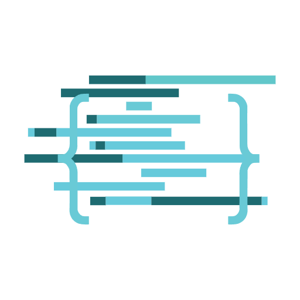

<p align="center">
  
</p>

# covdbg-mcp

MCP server for [covdbg](https://covdbg.com/): C++ code coverage on Windows for AI agents. Run tests, find uncovered code, and add targeted tests. No rebuild required.

covdbg measures coverage of the Windows binaries you already build, using their PDB debug information: x64, ARM64 and 32-bit x86. It works like a debugger: it starts your executable, reads the PDB, and places lightweight probes while the program runs. The MCP server is built into the `covdbg` executable (since v1.3.0) and is started with `covdbg mcp`.

This repository holds the MCP registry metadata (`server.json`, `glama.json`) and the [MCP Bundle](https://github.com/modelcontextprotocol/mcpb) manifest (`manifest.json`) for covdbg. The server itself ships with covdbg.

## What an agent can do

1. **Run coverage** on a test executable without rebuilding it.
2. **Rank files** by uncovered lines.
3. **Read the uncovered code** with surrounding context.
4. **Add a focused test**, re-run it, and confirm the gap is closed.
5. **Query** coverage databases (`.covdb`) with read-only SQL, and **merge** them, also across checkouts and builds.

## Requirements

- Windows x64, or Windows on ARM (ARM64)
- covdbg **1.3.0 or newer**. This README describes covdbg 1.5.1.
- An executable with PDB debug symbols (MSVC or any PDB-producing toolchain). The x64 covdbg measures x64 and 32-bit x86 programs; the ARM64 covdbg measures ARM64 programs (covdbg 1.5 and newer).
- A one-time `covdbg login` (covdbg 1.4 and newer sign in to one team, and runs need a seat in that team), or `COVDBG_PROJECT_TOKEN` for CI. A public repository in GitHub Actions needs neither (covdbg 1.5 and newer, see [Licensing in CI](#licensing-in-ci)).
- A `.covdbg.yaml` next to the target executable, or a `config_path` passed to `run` (see the [configuration reference](https://covdbg.com/docs/reference/configuration/))

## Install covdbg

- **Installer (recommended):** [installer.msi](https://covdbg.com/download/latest/installer.msi), or [installer-arm64.msi](https://covdbg.com/download/latest/installer-arm64.msi) for Windows on ARM. It installs to `%LocalAppData%\Programs\Liasoft\covdbg` and adds that directory to your user `PATH`.
- **Portable:** [portable.zip](https://covdbg.com/download/latest/portable.zip), or [portable-arm64.zip](https://covdbg.com/download/latest/portable-arm64.zip) for Windows on ARM. Extract it anywhere and add the directory to your `PATH` yourself. Keep the agent DLLs next to `covdbg.exe`: covdbg looks for them only there.

There is no separate 32-bit covdbg. The x64 build ships `libcovdbg32.dll`, a 32-bit build of its agent, and measures 32-bit programs with the same `covdbg.exe`.

Then open a new terminal and sign in:

```powershell
covdbg --version
covdbg login
```

Sign-in is team-scoped: in the browser you choose one team (your personal team, or a team you own or hold a seat in), and the agent's runs are licensed for that team. Use `covdbg login --team <slug>` to choose it up front, and `covdbg whoami` to see which team is active.

### Licensing in CI

In CI, set `COVDBG_PROJECT_TOKEN` in the server's environment; the run is licensed for the token's team.

A public repository in GitHub Actions needs no project token (covdbg 1.5 and newer). Grant the job `permissions: id-token: write`: without `COVDBG_PROJECT_TOKEN` and without a stored sign-in, covdbg presents the token GitHub issues to the job, which names the repository it runs in. GitHub issues no such token to a pull request from a fork. A private repository still needs a project token, and a project token that is set takes precedence.

## Client setup

The server uses **stdio** transport. Start it from your project directory, or pass `--workspace <dir>`.

| Option | Environment variable | Default | Purpose |
| --- | --- | --- | --- |
| `--workspace <dir>` | | working directory | The project directory; the default root for `discover` |
| `--query-timeout <ms>` | `COVDBG_MCP_QUERY_TIMEOUT_MS` | 5000 | How long one `query` statement may run, 1 to 600000 ms (covdbg 1.5 and newer). The option wins over the variable. |

### Claude Code

From the project directory:

```powershell
claude mcp add covdbg -- covdbg mcp
```

Or add a project `.mcp.json`:

```json
{
  "mcpServers": {
    "covdbg": {
      "command": "covdbg",
      "args": ["mcp"]
    }
  }
}
```

### VS Code

`.vscode/mcp.json`:

```json
{
  "servers": {
    "covdbg": {
      "type": "stdio",
      "command": "covdbg",
      "args": ["mcp", "--workspace", "${workspaceFolder}"]
    }
  }
}
```

### Cursor

`.cursor/mcp.json`:

```json
{
  "mcpServers": {
    "covdbg": {
      "command": "covdbg",
      "args": ["mcp"]
    }
  }
}
```

### Claude Desktop (MCP Bundle)

1. Download `covdbg.mcpb` from the [latest release](https://github.com/liasoft/covdbg-mcp/releases/latest).
2. Open it with Claude Desktop, or drag it into **Settings → Extensions**.
3. Set the following:
   - **covdbg executable:** the path to `covdbg.exe`. The default is the MSI install location.
   - **Workspace:** your project directory.
   - **Project token:** optional. Leave it empty if you have run `covdbg login`; runs are then licensed for the team you signed in to (see `covdbg whoami`).

The bundle does not contain covdbg itself. It launches your installed `covdbg.exe`, so covdbg updates take effect without a new bundle.

## Tools

| Tool | Purpose | Main inputs |
| --- | --- | --- |
| `guide` | Workflow and configuration guidance. Call it before the first run. | optional `topic` (`workflow`, `config`, `excludes`, `baseline`, `merging`, `uncovered`, `children`, `libraries`) |
| `discover` | Find executables and coverage databases | optional `root` |
| `run` | Start a coverage run; returns a run session right away | `target`; optional `target_arguments`, `config_path`, `output_path`, `follow_children` |
| `wait_run` | Wait briefly or collect the completed result | `session_id`; optional `timeout_seconds` |
| `cancel_run` | End a run: covdbg, the target and every process they started | `session_id` |
| `open_coverage` | Open an existing database read-only | `path` |
| `files` | Rank files by uncovered lines | `session_id`; optional `limit`, `max_coverage_percent` |
| `code` | Read uncovered source segments with context | `session_id`, `file_path` |
| `query` | Run one read-only SQL statement, within a time limit | `session_id`, `sql`; optional `max_rows` |
| `merge` | Combine databases, also from different checkouts and builds | `input_paths`, `output_path` |
| `close` | Release a run or coverage session | `session_id` |

### Limits and behavior

- Run session IDs start with `run-`; coverage session IDs start with `covdb-`.
- At most 8 runs in flight and 32 open coverage sessions. A run counts while its covdbg process is alive; once `wait_run` has seen it finish, it no longer takes a slot.
- `wait_run` blocks for at most 30 seconds. If it reports `stillRunning`, call it again.
- Run outcomes are `success`, `nothing_measured`, `license_failure`, or `error`. `nothing_measured` (`no_functions_to_track` before covdbg 1.5.1) means the target ran to its end, but no function passed the coverage filter, so the database covdbg wrote is empty; `outputLines` say why, after "nothing was measured". Before covdbg 1.5.1, the target did not run at all.
- covdbg's exit code does not carry the target's exit code, so check test results separately. From covdbg 1.5.1, covdbg says in `outputLines`, below the program's output, how the program exited.
- `cancel_run`, and `close` on a run that is still going, end the run's whole process tree at once: covdbg, the target and every process either of them started (covdbg 1.5.1 and newer; before, a process they started kept running until `close`). A run that cannot be set up that way is not started, and `run` says why.
- A `.covdbg.yaml` that covdbg refuses, such as a value of the wrong shape (`include: "src/**"` where a list belongs) or an unknown `type:`, ends the run with outcome `error`, and `outputLines` name the key with its line and column. A key covdbg does not know is a warning in `outputLines`, and the run goes on (covdbg 1.5.1 and newer).
- `follow_children` measures the processes the target starts. A launcher without debug information of its own, such as `ctest.exe` or `cmd.exe`, runs unmeasured and covdbg measures its children, so `run` with target `ctest.exe`, `target_arguments` `--test-dir build` and `follow_children` measures the test binaries CTest runs. Every process of one binary adds its hits to one database (covdbg 1.5 and newer).
- `query` stops a statement still running at the time limit, 5000 ms unless `--query-timeout` says otherwise, and answers with an error; the session stays open. It also bounds a statement's size: at most 100 KiB of SQL, expressions nested 250 deep, 100 `SELECT`s in one compound, `LIKE`/`GLOB` patterns of 1000 bytes, and 16 MiB for any one string or blob (covdbg 1.5 and newer).
- `merge` matches source files recorded in different checkouts by their path relative to each run's `source_root`, and keeps different builds at one module path, such as the x64 and ARM64 builds of a test, side by side (covdbg 1.5 and newer). `remappedModules` and `remappedFiles` say how many it matched that way.
- covdbg 1.5.1 writes coverage databases with schema 9 and refuses `.covdb` files written by covdbg 1.5.0 or earlier, and covdbg 1.5.0 refuses those of 1.5.1. `open_coverage` names both versions. Record that coverage again, with the same covdbg everywhere databases are merged or opened.

### Upgrading while the server runs

From covdbg 1.5.0, the installer can upgrade or uninstall covdbg while a client holds `covdbg mcp` open, without a reboot. The running server keeps answering from the old version, and the runs it starts use the newly installed `covdbg.exe`. Reconnect the server to get the new version of the server itself: in Claude Code, `/mcp` → covdbg → Reconnect.

## Environment variables

| Variable | Purpose |
| --- | --- |
| `COVDBG_PROJECT_TOKEN` | Project token for CI or headless use. Local use relies on `covdbg login`, which is bound to one team. |
| `COVDBG_OUTPUT` | Fixed default output location. Avoid reusing one location across a suite, since later runs overwrite earlier results. |
| `COVDBG_MCP_QUERY_TIMEOUT_MS` | Time limit for one `query` statement, 1 to 600000 ms (default 5000). A value outside that range is ignored. `--query-timeout` wins when both are given. |

## Documentation

- [MCP Server](https://covdbg.com/docs/integrations/mcp/)
- [Quick Start Using AI](https://covdbg.com/docs/getting-started/ai-quick-start/)
- [CLI Command Reference](https://covdbg.com/docs/reference/cli-reference/)
- [Data and Telemetry](https://covdbg.com/docs/reference/data-and-telemetry/)

## Publishing (maintainers)

Keep `version` in `manifest.json` and `server.json`, and the release tag in the `server.json` package URL, in sync.

1. Build the bundle. `.mcpbignore` limits it to `manifest.json`, `icon.png` and `LICENSE`:

   ```powershell
   npx @anthropic-ai/mcpb validate manifest.json
   npx @anthropic-ai/mcpb pack . covdbg.mcpb
   ```

2. Create the GitHub release `v<version>` and upload `covdbg.mcpb` as an asset.
3. Put the bundle's hash into `fileSha256` in `server.json`:

   ```powershell
   (Get-FileHash covdbg.mcpb -Algorithm SHA256).Hash.ToLower()
   ```

4. Publish to the [MCP registry](https://registry.modelcontextprotocol.io/). The `com.covdbg/*` namespace uses DNS authentication on `covdbg.com`:

   ```powershell
   mcp-publisher login dns --domain covdbg.com --private-key <key>
   mcp-publisher publish
   ```

5. [Glama](https://glama.ai/mcp/servers) picks up `glama.json` from the repository.

## License

The metadata in this repository is licensed under the [Apache License 2.0](LICENSE). covdbg itself is licensed separately, with Free, Team, and Enterprise plans. See [covdbg.com](https://covdbg.com/) and the [Licensing FAQ](https://covdbg.com/docs/reference/licensing-faq/).
